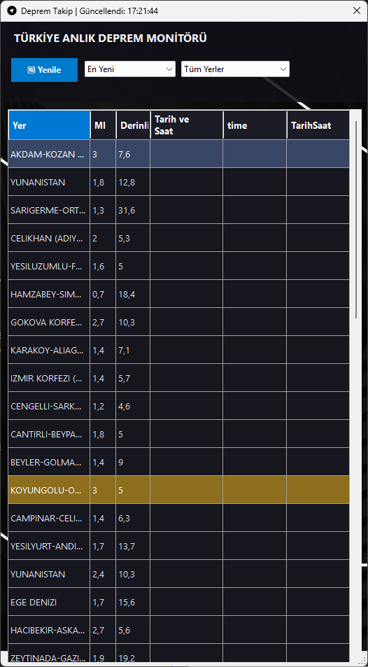

# 🌍 | Canlı Deprem Monitörü |

Türkiye'deki anlık deprem verilerini Kandilli Rasathanesi API altyapısını kullanarak takip eden, modern dikey (9:16) arayüze ve akıllı filtreleme özelliklerine sahip profesyonel bir C# Windows Forms masaüstü uygulamasıdır.



---

## 🚀 Öne Çıkan Özellikler

* **Canlı Veri Akışı:** Kandilli Rasathanesi canlı deprem servisinden (`orhanaydogdu.com.tr`) asenkron olarak güncel verileri çeker.
* **Akıllı Zamanlayıcı (Timer):** Veriler her 30 saniyede bir arayüzü dondurmadan arka planda otomatik olarak güncellenir.
* **Dikey (9:16) Modern Arayüz:** Standart gri form görünümünden uzak, özel arka plan görseli, şeffaf cam efektli üst panel ve koyu tema (Dark Mode) estetiği.
* **Gelişmiş Filtreleme ve Sıralama:** 
  * Şehre/Yere göre anlık filtreleme (`ComboBox`).
  * En yeni, en büyük büyüklük (Ml) ve en küçük büyüklük kriterlerine göre sıralama.
* **Dinamik Renklendirme:** Depremin büyüklüğüne (`mag`) göre satırlar otomatik olarak renklendirilir:
  * 🔴 **4.0 ve üzeri:** Belirgin dikkat çekici kırmızı vurgu.
  * 🟡 **3.0 - 4.0 arası:** Turuncu/Sarı uyarı vurgusu.
* **Yüksek Performans:** `DoubleBuffered` optimizasyonu ve yönetilen `HttpClient` yapısı sayesinde akıcı, takılmasız kullanıcı deneyimi.

---

## 🛠️ Kullanılan Teknolojiler ve Mimari

* **Dil:** C#
* **Framework:** .NET (Windows Forms)
* **Ağ İstekleri:** `HttpClient` (Asenkron `async/await` mimarisi, zaman aşımı yönetimi)
* **Veri İşleme:** `System.Text.Json` (Yüksek performanslı JSON serileştirme)
* **Arayüz Tasarımı:** Özel `DataGridView` yapılandırması ve optimize edilmiş yerleşim.

---

## 📦 Kurulum ve Çalıştırma

Projeyi kendi bilgisayarınızda çalıştırmak için şu adımları izleyebilirsiniz:

1. Depoyu klonlayın:
   ```bash
   git clone [https://github.com/makifblc/DepremTakipApp.git](https://github.com/makifblc/DepremTakipApp.git)
